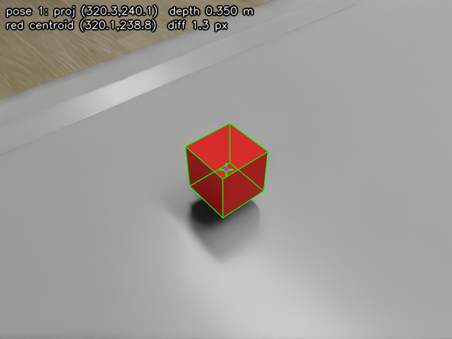

# UR5e Isaac Sim demo + wrist camera

UR5e in Isaac Sim 6.0 driven by MoveIt on ROS 2 Jazzy. I added a wrist camera and a script that photographs a cube from 5 poses and checks the saved poses by projecting the cube back into the images.

The projected cube centre lands 2.1 px on average (4.3 px max) from the centre of the red pixels. Annotated images are in `captures/annotated/`.



Green is the cube projected from the saved pose and intrinsics, the magenta dot is the red pixel centroid.

## Changes

- `urdf/ur_isaac.urdf.xacro`: added `camera_link` and `camera_optical_frame` on `tool0`.
- `scripts/spawn_ur5e.py`: adds the camera, its ROS publishers and the cube. New options: `--urdf`, `--cube-xyz`, `--cube-size`, `--no-cube`.
- `scripts/capture_wrist_images.py`: moves the arm and saves images and poses.
- `scripts/verify_projection.py`: the projection check.
- `scripts/check_camera_topics.py`, `scripts/snap_tf_overlay.py`: small tools I used to check the camera.
- `rviz/ur5e_wrist_cam.rviz`: MoveIt layout plus a Camera display.
- `run_isaac_host.sh`: for running Isaac outside the ROS environment, see below.
- `captures/`: output of the run described here.

Topics:

- `/wrist_cam/image_raw`: 640x480 rgb8, 15 Hz sim time, frame `camera_optical_frame`
- `/wrist_cam/camera_info`: same rate and frame. fx = fy = 549.75, cx = 320, cy = 240

## Build

```bash
sudo apt install ros-jazzy-moveit ros-jazzy-ros2-control ros-jazzy-ros2-controllers \
  ros-jazzy-rviz2 ros-jazzy-robot-state-publisher ros-jazzy-xacro ros-jazzy-cv-bridge \
  ros-jazzy-tf2-tools python3-opencv python3-vcstool

cd ros2_ws
vcs import src < ur5e_isaac.repos
git -C src/Universal_Robots_ROS2_Description checkout 2dd8298   # vcs pulls a newer commit than the repo pin
git -C src/Universal_Robots_ROS2_Driver sparse-checkout set ur_moveit_config

source /opt/ros/jazzy/setup.bash
colcon build --symlink-install --cmake-args -DBUILD_TESTING=OFF
source install/setup.bash
```

`-DBUILD_TESTING=OFF` skips test dependencies of `topic_based_ros2_control`.

## Run

```bash
ros2 launch ur5e_isaac_bridge ur5e_isaac.launch.py
```

RViz opens with a camera panel showing the robot model over the image. Plan any move with `ur_manipulator` and check that the two line up.

```bash
ros2 run ur5e_isaac_bridge check_camera_topics.py
ros2 run tf2_ros tf2_echo base_link camera_optical_frame
```

With that running, capture and check:

```bash
ros2 run ur5e_isaac_bridge capture_wrist_images.py --out captures
ros2 run ur5e_isaac_bridge verify_projection.py captures
```

Output from the run in `captures/`:

```
pose   proj u   proj v  depth m in img  red px  diff px
   0    319.4    241.0    0.350   True    8892      2.1
   1    320.3    240.1    0.350   True   10548      1.3
   2    320.8    239.3    0.350   True   10597      1.4
   3    319.1    239.5    0.300   True   12502      1.3
   4    320.0    238.3    0.299   True   10077      4.3
projected centre vs red centroid: mean 2.1 px, max 4.3 px
```

The cube is at (0.5, 0.0, 0.0403) in `base_link`, 5 cm edge. `poses.jsonl` has one line per image with the joint angles and the `base_link` to `camera_optical_frame` pose, looked up at the image stamp.

## Design notes

**Camera frames.** They are in the xacro so TF and MoveIt know about the camera. The importer keeps them because `merge_fixed_joints=False`, and the USD camera is a child of the imported `camera_optical_frame`, so Isaac and ROS use the same mount.

**USD vs ROS axes.** The optical frame looks along +Z with +Y down, a USD camera looks along -Z with +Y up. So the USD camera has a 180 degree rotation about X under the optical frame.

**Mount.** 6 cm off the tool axis and 4 cm from the flange. I started at 2 cm but the collision box was inside `wrist_3_link`, so every state was in collision and IK failed everywhere.

**15 Hz.** Rendering steps at 60 Hz, the helpers publish every 4th frame. Stamps are sim time, I measured the rate from those (`ros2 topic hz` shows about 23 Hz since the sim runs faster than real time).

**Poses.** Instead of tuning joint angles I pick camera positions on a sphere around the cube, build a look-at pose, convert it to `tool0` and get a joint goal from `/compute_ik`. The planner kept failing when IK returned a far branch, so it now tries a few seeds and takes the solution closest to the current joints. Some arm shapes put the forearm in front of the lens, which I only saw when a run started from a different pose. So the script now counts red pixels before saving and tries the next IK solution if the cube is blocked. There are 7 candidate views and it stops after 5 work.

**Arm stopped.** After MoveIt returns I wait until no joint moves more than 0.2 mrad over 0.5 s of sim time, then take the first image stamped after that. I use positions because PhysX reports small velocities at rest. TF is looked up at the image stamp.

**Check.** `verify_projection.py` only uses the saved files. The red centroid is the centre of the visible faces rather than the cube centre, so a few px is expected. The wireframe matching the cube edges is the better check.

## Known issues

- I developed this on Fedora 43, with Isaac on the host and ROS in an Ubuntu 24.04 toolbox. The normal launch that starts Isaac itself was not run on Ubuntu.
- `frameSkipCount` is deprecated in Isaac 6.0, the replacement is `omni:sensor:tickRate` on the camera prim. I kept it since the rate is exact.
- The robot base sits about 1.5 cm into the `simple_room` table (table top is at z = 0.0153). The cube is on the real surface, but MoveIt's table is below z = 0 so the base doesn't collide with it.
- OMPL is random, so planning sometimes fails (the near top-down view most often). The script retries and has spare views, so which 5 views you get can change between runs.
- The check for a blocked cube looks for red pixels, so it only works with the red cube.
- On a small screen RViz opens with the camera panel squashed under MotionPlanning. Close the Displays and MotionPlanning panels or drag the divider up (Panels menu brings them back). The arm also has to be pointing at the cube for it to show up in that panel.
- Depth images not done.

## Running without ROS on the host

Isaac's ROS bridge only picks a distro on Ubuntu. On Fedora it falls back to Humble and fails. `run_isaac_host.sh` expands the xacro in the container and starts Isaac with its bundled Jazzy libraries:

```bash
./run_isaac_host.sh                  # on the host
ros2 launch ur5e_isaac_bridge ur5e_isaac.launch.py launch_isaac:=false   # in the container
```

The container shares the host network, so topics work with default settings.

## AI tools

AI tools used: ChatGPT and Claude (Claude Code). I can explain every part of the code and the design choices above.

## Original demo notes

### Packages

| Package | Role |
|---|---|
| `ur_description` | Official URDF, meshes, and kinematics from [Universal_Robots_ROS2_Description](https://github.com/UniversalRobots/Universal_Robots_ROS2_Description), branch `jazzy`. |
| `ur_moveit_config` | Official MoveIt config. `Universal_Robots_ROS2_MoveIt_Config` is no longer a separate repository; the package lives in [Universal_Robots_ROS2_Driver](https://github.com/UniversalRobots/Universal_Robots_ROS2_Driver), branch `jazzy`. This workspace keeps a sparse checkout of `ur_moveit_config` only. |
| `topic_based_ros2_control` | ros2_control hardware interface from [PickNikRobotics/topic_based_ros2_control](https://github.com/PickNikRobotics/topic_based_ros2_control). It publishes joint commands and subscribes to joint states so MoveIt can drive the simulated arm. |
| `ur5e_isaac_bridge` | Launch package for this demo. It imports the UR5e URDF into Isaac Sim, creates the ROS 2 bridge action graph, and starts `ros2_control` and MoveIt after `/clock` and `/isaac_joint_states` are publishing. |

Upstream pins are listed in `ros2_ws/ur5e_isaac.repos`.

### Launch arguments

| Argument | Default | Meaning |
|---|---|---|
| `ur_type` | `ur5e` | Robot model passed to the Universal Robots description. |
| `launch_isaac` | `true` | Start Isaac Sim from this launch. Set `false` to attach MoveIt to a simulator that is already running. |
| `launch_rviz` | `true` | Start RViz with the wrist-camera layout. |
| `use_sim_time` | `true` | Use `/clock` from Isaac Sim. |
| `headless` | `false` | Run the Isaac Sim app without a window. |
| `isaac_python` | `~/isaacsim/python.sh` | Isaac Sim Python launcher. |
| `joint_commands_topic` | `/isaac_joint_commands` | Commands from ros2_control into Isaac Sim. |
| `joint_states_topic` | `/isaac_joint_states` | Joint states from Isaac Sim into ros2_control. |

The first Isaac Sim startup can take longer than the launch's 180 second wait. If the log reports that the bridge timed out and MoveIt was not launched, leave the simulator running and start MoveIt against it:

```bash
ros2 launch ur5e_isaac_bridge ur5e_isaac.launch.py launch_isaac:=false
```

The ROS terminal and Isaac Sim need the same `ROS_DOMAIN_ID`. The bridge graph uses the domain from that environment variable.
